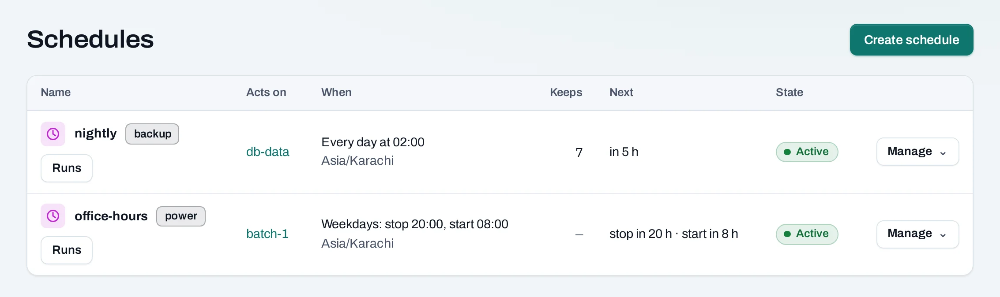
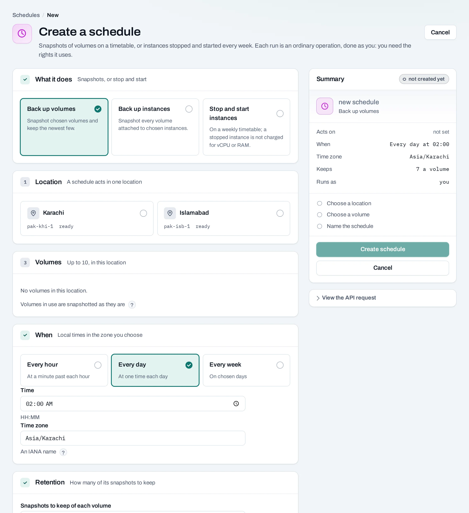

# Schedules

A **schedule** does something on its own, on a timetable you set:

- A **backup schedule** snapshots volumes hourly, daily or weekly and keeps the newest few of its
  own snapshots of each volume.
- A **power schedule** stops instances and starts them again on a weekly timetable, for example
  stopped every weekday at 20:00 and started at 08:00.
- A **size schedule** sets an [instance group](../compute/instance-groups.md)'s count at set
  times.

Find them under **Storage → Schedules**, or on a volume's or an instance's **Schedules** tab.



## Before you start

Each run is an ordinary operation, made as the person who created the schedule or last changed or
resumed it. You need the rights the runs use: snapshotting and deleting snapshots for a backup,
stopping and starting instances for a power schedule. A project reader cannot make one.

## Add a schedule

=== "Console"

    1. Choose **Create schedule**, or **Add schedule** on a volume's or instance's **Schedules**
       tab.
    2. What it does: **Back up volumes**, **Back up instances** (every volume attached to each
       instance) or **Stop and start instances**.
    3. The location and up to 10 volumes or instances there.
    4. When, and the time zone, such as `Asia/Karachi`.
    5. For a backup, how many snapshots to keep of each volume (1 to 100).
    6. Name it and choose **Create schedule**.

    

=== "API"

    ```bash
    curl -sS -X POST "$NUBESTACK_API/v1/orgs/$ORG/projects/$PROJECT/schedules" \
      -H "Authorization: Bearer $NUBESTACK_API_KEY" \
      -H "Idempotency-Key: $(uuidgen)" \
      -H "Content-Type: application/json" \
      -d '{
        "kind": "backup", "name": "nightly",
        "target_type": "volume", "target_ids": ["vol_01jbdbdata"],
        "time_zone": "Asia/Karachi",
        "recurrence": {"frequency": "daily", "time": "02:00"},
        "keep": 7
      }'
    ```

    A power schedule: `"kind": "power"`, `"target_type": "server"` and
    `"power": {"days": ["mon","tue","wed","thu","fri"], "stop_at": "20:00", "start_at": "08:00"}`.
    A size schedule: `"kind": "resize"`, `"target_type": "instance_group"` and `"desired"`. The
    answer is `201 Created`.

## When it runs

- Times are local to the schedule's time zone. A run starts within about a minute of its time.
- When daylight saving skips an hour, a run in it happens once, just after; when an hour repeats,
  it runs the first time.
- If a run was missed, only the latest missed run happens, once; there is no backlog. If the
  previous run is still going, the next is skipped, and the skip is shown.
- While the organization or project is suspended, nothing runs; a project's schedules pause when
  its deletion is requested.

**Runs** on a schedule lists its latest runs, with links to their operations.

## Backups and how many are kept

Backup snapshots are named after the schedule and the time, for example `nightly-20261029-0200`.
They are ordinary [snapshots](snapshots.md): restore one to a new volume as usual.

After a run's snapshot of a volume succeeds, the schedule deletes that volume's oldest snapshots
**it made** beyond **Keeps**. It never deletes a snapshot you made by hand or one another schedule
made, and deletes nothing when a run failed.

<figure class="ns-diagram">
--8<-- "backup-retention.svg"
<figcaption>A nightly schedule keeping 7: after each successful run the oldest snapshot it made goes; a failed run, and snapshots it did not make, change nothing.</figcaption>
</figure>

A volume in use is snapshotted as it is, as if the power had been cut (crash-consistent). For a
database, use its own backup tool, or stop it first. An instance's system disk that is not a
volume is not snapshotted; save the instance as an [image](../compute/images.md) for that.

## Power schedules

At a stop time each running instance is stopped; at a start time each stopped one is started. An
instance already in that state is left alone. The instance's page shows its next stop and start.
A stopped instance is not counted for vCPU and RAM hours, but its disks and public IPs still are.

## Pause, resume, change or delete

=== "Console"

    **Manage → Pause…** stops it running; runs missed while paused are not made up. **Resume**
    starts it again from its next time. **Edit** changes it. **Delete…** removes it.

=== "API"

    Changes need the schedule's version in `If-Match`:

    ```bash
    curl -sS -X POST "$NUBESTACK_API/v1/orgs/$ORG/projects/$PROJECT/schedules/sch_01jbnightly:pause" \
      -H "Authorization: Bearer $NUBESTACK_API_KEY" \
      -H "Idempotency-Key: $(uuidgen)" \
      -H 'If-Match: "3"'
    ```

    `:resume`, `PATCH` and `DELETE` work the same way and answer `200 OK`.

Deleting a backup schedule keeps the snapshots it made, and they are no longer pruned. Nothing
blocks deleting a schedule.

## When a run fails

The person the schedule runs as gets an e-mail when a run fails, and when the schedule pauses
itself because they lost the rights or everything it acts on is gone. A run of failures sends one
e-mail. If they have left the organization, its owners and admins get it. Anyone who may manage
the schedule can **Resume** it; it then runs as them.

## Limits

- Up to 20 schedules per project and 10 targets per schedule, in one location.
- Nothing runs more often than once an hour.

## Related

- [Snapshots](snapshots.md) · [Instance groups](../compute/instance-groups.md)
- [API reference: Schedules](../api/reference/schedules.md)
