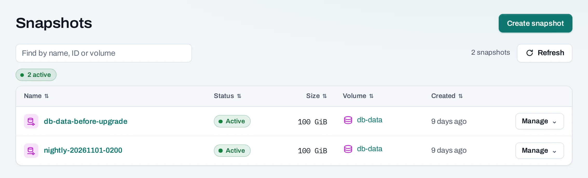
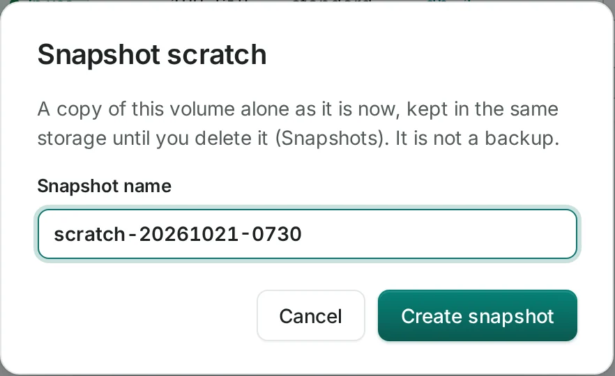
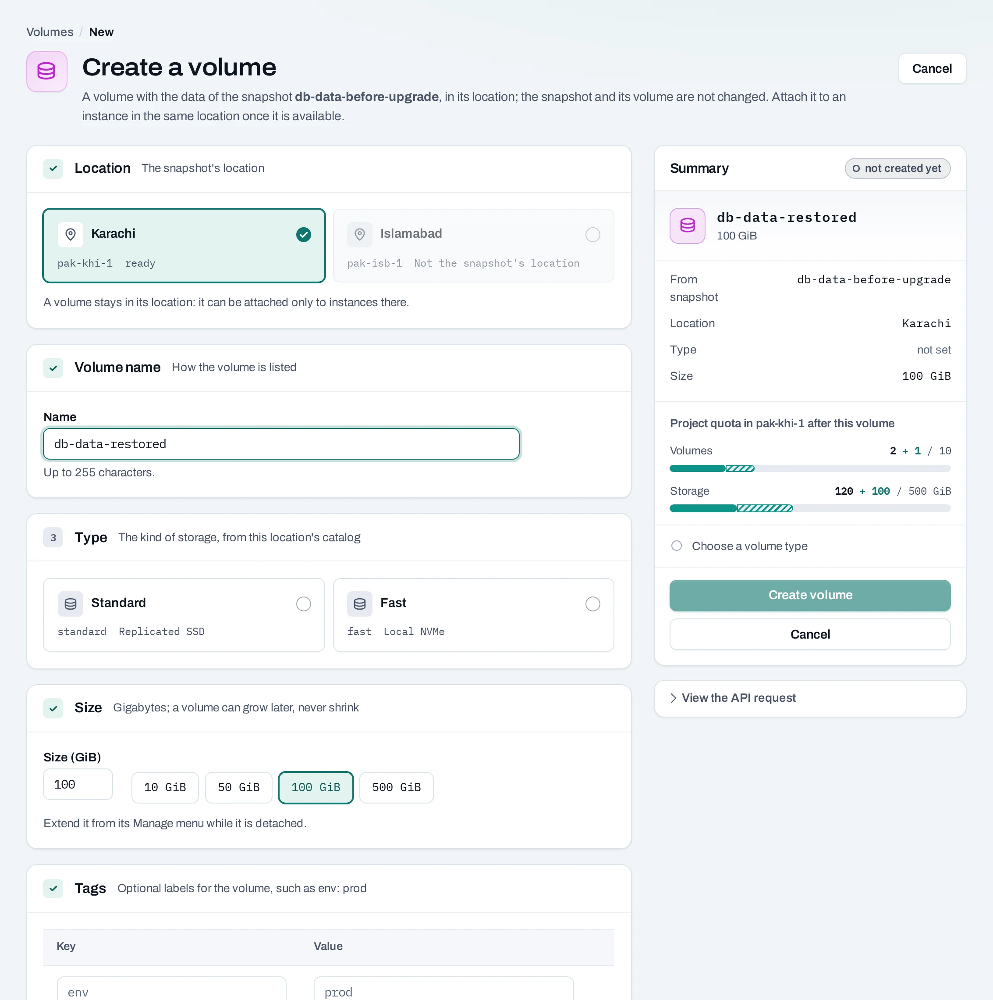

# Snapshots

A snapshot is a point-in-time copy of a volume in the same location. Use one before a change, or use a [schedule](/storage/schedules.md) to keep regular recovery points. Restoring creates a new volume; it does not overwrite the original.

!!! warning "Snapshots share the source storage"

    A snapshot is stored with its source volume. It does not protect against losing that storage. NubeStack Cloud does not currently offer backup copies to separate storage; keep an independent application backup if your recovery plan requires one.

## Create a snapshot

1. Stop application writes and unmount the source volume inside its instance.
2. Detach the volume. Manual snapshots are refused while it is attached.
3. In **Storage → Volumes**, choose **Manage → Create snapshot**.
4. Name the snapshot, create it and follow the operation.
5. Find it under **Storage → Snapshots** or on the source volume's page. Reattach the source volume if required.

A backup schedule can snapshot attached volumes. Such a snapshot is a disk-level recovery point; it does not coordinate transactions in your database or capture memory. Use application-aware backup or quiesce the application when consistency across writes matters.

## Restore to a new volume

From the snapshot's menu choose the restore/create-volume action. Give the new volume a name, type and size at least as large as the source. Follow the operation, then attach the restored volume to an instance in this location. Check its data before switching the application to it.

You can also start on **Create volume** and select the snapshot as the source. A snapshot is not a cross-location backup; keep an independent copy if you need recovery from a location outage.

## Rename or delete

Use **Rename** on the snapshot to change its display name. Delete only after confirming it is no longer a required recovery point. A snapshot can block deletion of its source volume. Deleting a backup schedule keeps the snapshots already created, and they stop being pruned by that schedule.

## With the API

Set `VOLUME_ID` to the source volume's ID.

<!-- api-example: snapshot_volume -->

List with `GET {P}/volume-snapshots`, rename with `PATCH {P}/volume-snapshots/{id}`, and delete with `DELETE {P}/volume-snapshots/{id}`. To restore, send `POST {P}/volumes` with `snapshot_id`, `location`, `display_name`, `size_gb` and `volume_type`. These changes return `202` and an operation.

## Limits and good practice

Snapshot counts and storage are limited by project quota in the location. Wait for a successful operation before relying on a new snapshot. Test restoration regularly; a successful snapshot operation alone is not a recovery test.
