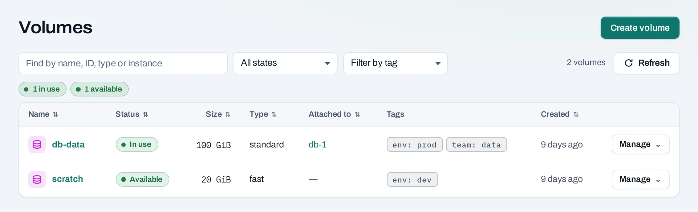
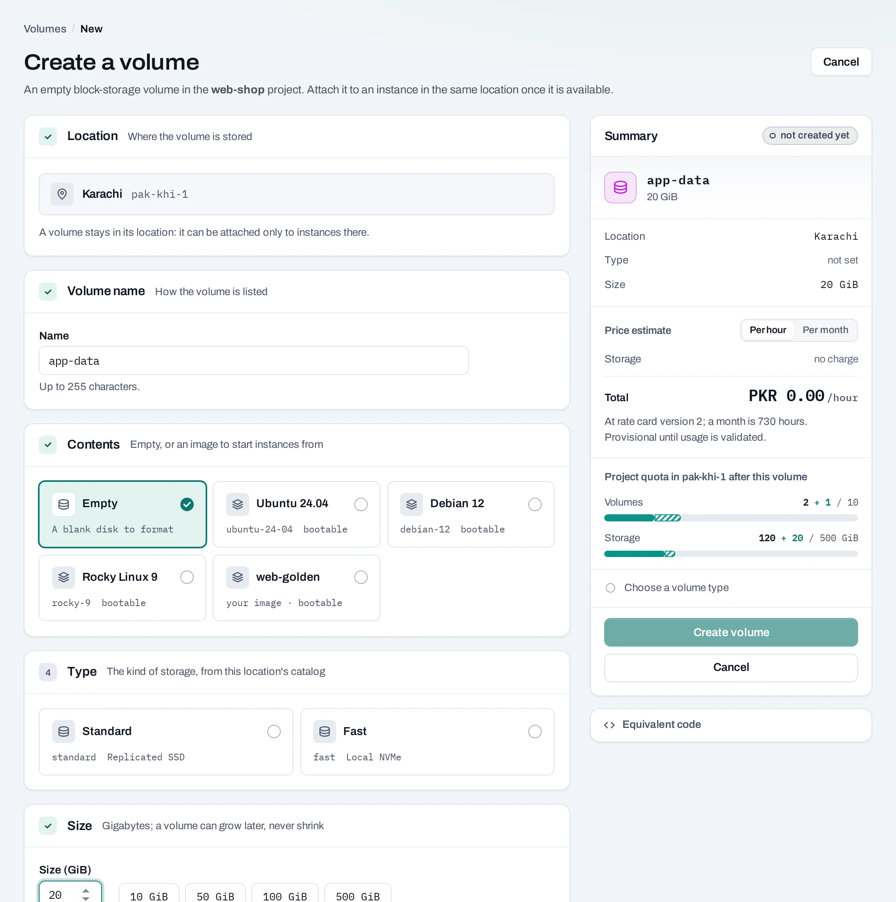
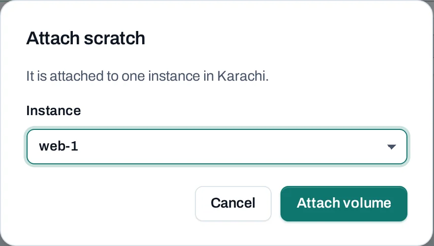
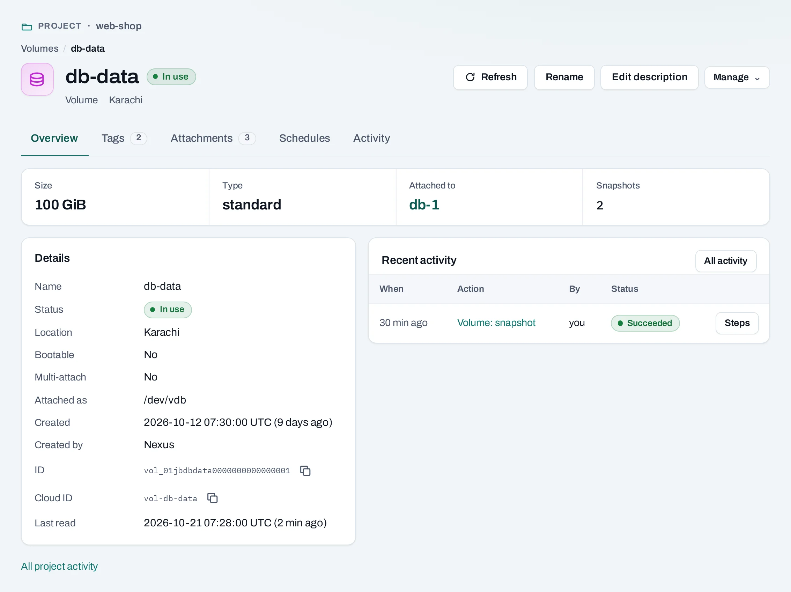
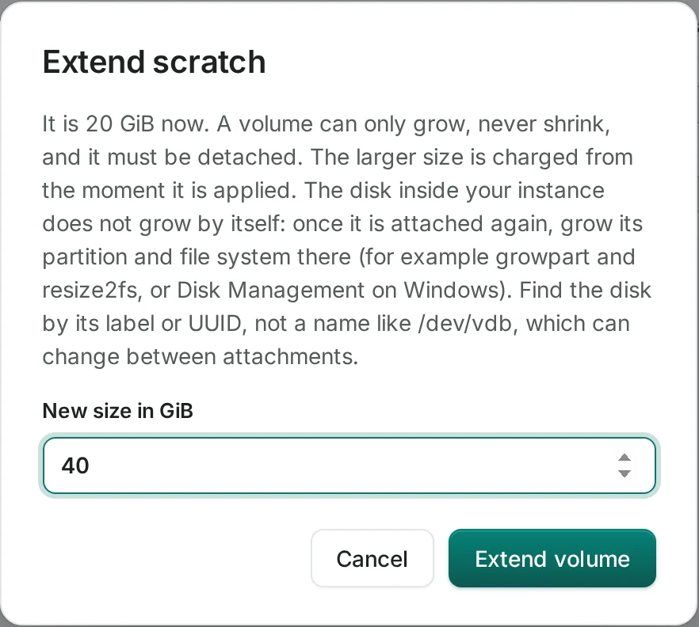
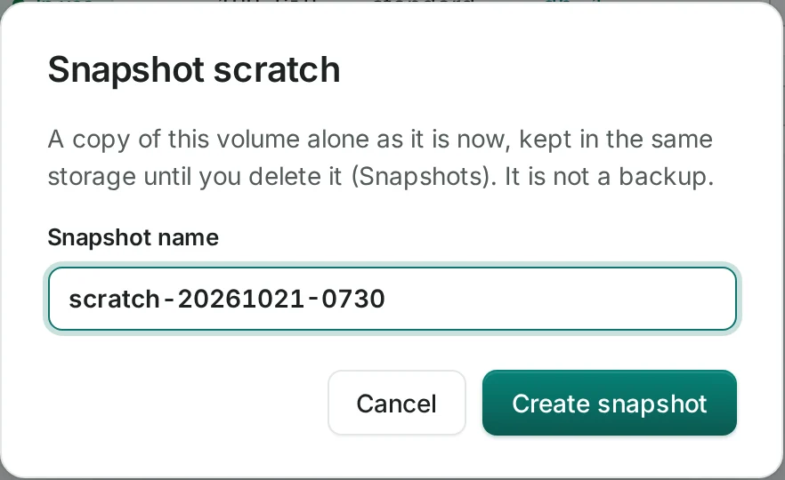

# Volumes

A volume is a persistent disk in one location. Use it for application data that should survive replacing an instance. A separate data volume is retained after instance deletion.

<div class="docs-method-picker" hidden role="group" aria-label="Instruction method">
<span>Show instructions for</span>
<div><button type="button" data-interface-choice="Console" aria-pressed="true">Console</button><button type="button" data-interface-choice="API" aria-pressed="false">API</button></div>
</div>

<div class="docs-method-note" markdown>

[Set up API authentication and variables](../api/index.md#before-you-start). Replace example IDs and catalog choices. Reuse an idempotency key for retries of one request; use a new key for each new action.

</div>




## Create a volume

=== "Console"

    1. Open **Storage → Volumes → Create volume**.
    2. Choose the location, name, size and offered type.
    3. Start empty, from an image or from a snapshot in this location. Make the volume large enough for its source.
    4. Add tags, review quota, then create and follow the operation.

    

=== "API"

    <span id="with-the-api" data-docs-method="API"></span>

    ```bash
    curl --fail-with-body -i -X POST "$NUBESTACK_API/v1/orgs/$ORG/projects/$PROJECT/volumes" \
      -H "Authorization: Bearer $NUBESTACK_API_KEY" \
      -H "Idempotency-Key: $REQUEST_KEY" \
      -H "Content-Type: application/json" \
      --data '{
      "location": "loc_example",
      "display_name": "web-data",
      "size_gb": 20,
      "volume_type": "standard",
      "tags": {
        "env": "prod"
      }
    }'
    ```

    A `202` accepts the change. Follow `operation.href` to its final result before the next dependent action.

    [Request fields and responses](../api/reference/volumes-and-snapshots.md).


## Attach and use it

=== "Console"

    Choose **Manage → Attach** and an instance in the same project and location. The disk becomes available to the guest; mounting and filesystem preparation happen inside the guest. Identify it with `lsblk`. Format only a new empty disk, never a disk containing restored or existing data.

    

    The volume's detail page links its instance, snapshots, schedules and activity. Multi-attach, where offered, requires an application or filesystem designed for shared disks; ordinary simultaneous filesystem writes can corrupt data.

    

=== "API"

    ```bash
    curl --fail-with-body -i -X POST "$NUBESTACK_API/v1/orgs/$ORG/projects/$PROJECT/servers/$SERVER_ID:attach-volume" \
      -H "Authorization: Bearer $NUBESTACK_API_KEY" \
      -H "Idempotency-Key: $REQUEST_KEY" \
      -H "Content-Type: application/json" \
      --data '{
      "volume_id": "vol_example"
    }'
    ```

    A `202` accepts the change. Follow `operation.href` to its final result before the next dependent action.

    [Request fields and responses](../api/reference/instances.md).


## Detach a volume

=== "Console"

    Stop application writes and unmount the filesystem inside the guest, then choose **Manage → Detach**. For a multi-attach disk, choose which instance loses access. Wait for the detach operation before moving, resizing or deleting the disk.

=== "API"

    ```bash
    curl --fail-with-body -i -X POST "$NUBESTACK_API/v1/orgs/$ORG/projects/$PROJECT/servers/$SERVER_ID:detach-volume" \
      -H "Authorization: Bearer $NUBESTACK_API_KEY" \
      -H "Idempotency-Key: $REQUEST_KEY" \
      -H "Content-Type: application/json" \
      --data '{
      "volume_id": "vol_example"
    }'
    ```

    A `202` accepts the change. Follow `operation.href` to its final result before the next dependent action.

    [Request fields and responses](../api/reference/instances.md).


## Extend a volume

=== "Console"

    Unmount and detach first. Choose **Manage → Extend**, enter a larger size and confirm. Keep it detached until available, then reattach and grow its guest partition and filesystem. Shrinking is not supported.

    

=== "API"

    ```bash
    curl --fail-with-body -i -X POST "$NUBESTACK_API/v1/orgs/$ORG/projects/$PROJECT/volumes/$VOLUME_ID:extend" \
      -H "Authorization: Bearer $NUBESTACK_API_KEY" \
      -H "Idempotency-Key: $REQUEST_KEY" \
      -H "Content-Type: application/json" \
      --data '{
      "size_gb": 40
    }'
    ```

    A `202` accepts the change. Follow `operation.href` to its final result before the next dependent action.

    [Request fields and responses](../api/reference/volumes-and-snapshots.md).


## Change the volume type

=== "Console"

    Unmount and detach first. Choose **Manage → Change type**, select a type offered in this location and confirm. Keep the volume detached until the operation makes it available again.

=== "API"

    ```bash
    curl --fail-with-body -i -X POST "$NUBESTACK_API/v1/orgs/$ORG/projects/$PROJECT/volumes/$VOLUME_ID:retype" \
      -H "Authorization: Bearer $NUBESTACK_API_KEY" \
      -H "Idempotency-Key: $REQUEST_KEY" \
      -H "Content-Type: application/json" \
      --data '{
      "volume_type": "standard"
    }'
    ```

    A `202` accepts the change. Follow `operation.href` to its final result before the next dependent action.

    [Request fields and responses](../api/reference/volumes-and-snapshots.md).


## Change the bootable marker

=== "Console"

    Choose **Manage → Mark bootable** or **Mark not bootable**. The marker changes; it does not move data or enable volume-backed instance creation in this console.

=== "API"

    ```bash
    curl --fail-with-body -i -X POST "$NUBESTACK_API/v1/orgs/$ORG/projects/$PROJECT/volumes/$VOLUME_ID:set-bootable" \
      -H "Authorization: Bearer $NUBESTACK_API_KEY" \
      -H "Idempotency-Key: $REQUEST_KEY" \
      -H "Content-Type: application/json" \
      --data '{
      "bootable": true
    }'
    ```

    A `202` accepts the change. Follow `operation.href` to its final result before the next dependent action.

    [Request fields and responses](../api/reference/volumes-and-snapshots.md).


## Move a volume to another project

=== "Console"

    Unmount and detach the disk, then choose **Manage → Move to project**. Select another project you can use in the same location. Resolve snapshots or other dependencies named by the refusal. A move changes the project holding the disk; it does not copy it to another location.

=== "API"

    ```bash
    curl --fail-with-body -i -X POST "$NUBESTACK_API/v1/orgs/$ORG/projects/$PROJECT/volumes/$VOLUME_ID:transfer" \
      -H "Authorization: Bearer $NUBESTACK_API_KEY" \
      -H "Idempotency-Key: $REQUEST_KEY" \
      -H "Content-Type: application/json" \
      --data '{
      "target_project_id": "prj_example"
    }'
    ```

    A `202` accepts the change. Follow `operation.href` to its final result before the next dependent action.

    [Request fields and responses](../api/reference/volumes-and-snapshots.md).


## Create a snapshot

=== "Console"

    Detach the volume, then choose **Manage → Create snapshot** and name the recovery point. Manual snapshots require detachment. A backup-kind schedule can snapshot an attached volume without pausing the application, but still stores the snapshot with its source storage.

    

    For a tested restore, follow [Recover a volume](../tutorials/persistent-storage.md).

=== "API"

    ```bash
    curl --fail-with-body -i -X POST "$NUBESTACK_API/v1/orgs/$ORG/projects/$PROJECT/volumes/$VOLUME_ID:snapshot" \
      -H "Authorization: Bearer $NUBESTACK_API_KEY" \
      -H "Idempotency-Key: $REQUEST_KEY" \
      -H "Content-Type: application/json" \
      --data '{
      "display_name": "before-upgrade"
    }'
    ```

    A `202` accepts the change. Follow `operation.href` to its final result before the next dependent action.

    [Request fields and responses](../api/reference/volumes-and-snapshots.md).


## Change tags

=== "Console"

    Open the volume's **Tags** tab and save the complete desired set. Tags organize resources and later cost grouping; they do not change earlier usage history.

=== "API"

    ```bash
    curl --fail-with-body -i -X PUT "$NUBESTACK_API/v1/orgs/$ORG/projects/$PROJECT/volumes/$RESOURCE_ID/tags" \
      -H "Authorization: Bearer $NUBESTACK_API_KEY" \
      -H "Idempotency-Key: $REQUEST_KEY" \
      -H "If-Match: $ETAG" \
      -H "Content-Type: application/json" \
      --data '{
      "tags": {
        "env": "prod"
      }
    }'
    ```

    A `202` accepts the change. Follow `operation.href` to its final result before the next dependent action.

    [Request fields and responses](../api/reference/volumes-and-snapshots.md).


## Rename a volume

=== "Console"

    Choose **Rename** on the volume's detail page, enter a clear display name and save. Its ID and data remain the same.

=== "API"

    ```bash
    curl --fail-with-body -i -X PATCH "$NUBESTACK_API/v1/orgs/$ORG/projects/$PROJECT/volumes/$RESOURCE_ID" \
      -H "Authorization: Bearer $NUBESTACK_API_KEY" \
      -H "Idempotency-Key: $REQUEST_KEY" \
      -H "Content-Type: application/json" \
      --data '{"display_name": "application-data"}'
    ```

    A `202` accepts the change. Follow `operation.href` to its final result before the next dependent action.

    [Request fields and responses](../api/reference/volumes-and-snapshots.md).


## Delete a volume

=== "Console"

    Unmount and detach it first, then choose **Delete** and confirm permanent data removal. Remaining snapshots can also block deletion; the refusal names attached instances or snapshots. Keep a separate copy of data you still need.

=== "API"

    ```bash
    curl --fail-with-body -i -X DELETE "$NUBESTACK_API/v1/orgs/$ORG/projects/$PROJECT/volumes/$VOLUME_ID" \
      -H "Authorization: Bearer $NUBESTACK_API_KEY" \
      -H "Idempotency-Key: $REQUEST_KEY"
    ```

    A `202` accepts the change. Follow `operation.href` to its final result before the next dependent action.

    [Request fields and responses](../api/reference/volumes-and-snapshots.md).


## Limits and good practice

The API accepts 1–4,096 GiB; quota and volume types can impose lower limits. Attached and unattached disks both count as allocated storage. Guest filesystem growth is separate from cloud extension. [Use persistent storage](../tutorials/persistent-storage.md) walks through guest preparation and mounting.
