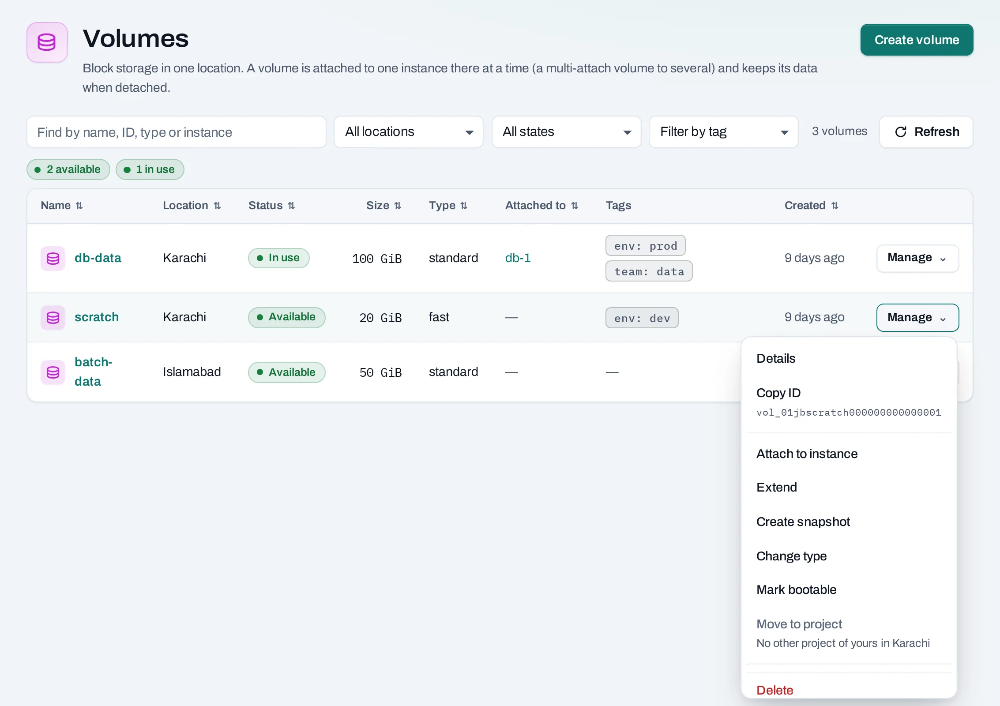

# Volumes

A volume is a persistent disk in one location. Attach it to an instance for data that must survive replacing the instance. A volume is separate from the instance's system disk and remains after the instance is deleted.

## Create a volume

1. Open **Storage → Volumes → Create volume**.
2. Choose a location, name, size in GiB and a volume type offered there.
3. Start empty, from an image, or from a [snapshot](/storage/snapshots.md). A source must be in this location, and the new volume must be large enough for it.
4. Add tags, review quota and create. Follow the operation until the volume is available.

## Attach and use it

Choose **Manage → Attach** and select an instance in the same project and location. You can also attach from the instance's menu or choose data volumes during instance creation.

Inside the instance, identify the disk with `lsblk`. A new empty disk needs a filesystem and mount point; a disk restored from a snapshot already contains data. Check carefully before formatting. Mount by filesystem UUID if the attachment device name may change.

Open the volume to see its attached instance, snapshots, schedules, tags and activity.

If the volume and location support **multi-attach**, the menu can attach it to another instance. Only use that with a filesystem or application designed for shared disks. Mounting an ordinary filesystem for simultaneous writes on several instances can corrupt data; multi-attach does not coordinate those writes.

## Change a volume

The same **Manage** menu appears on the list and detail page.

| Action | What to do |
|---|---|
| Detach | Stop writes and unmount inside the instance first; then detach in the console |
| Extend | Unmount and detach first. Choose a larger size; shrinking is not supported. Reattach after the operation, then grow the guest partition and filesystem |
| Change type | Unmount and detach first. Choose an offered type and keep the volume detached until the operation makes it available again |
| Bootable | Change the disk's bootable marker; this does not make volume-backed instance launch available in this console |
| Move to project | Choose another project you can use in the same location. Detach first and resolve snapshots or other dependencies named by the refusal |
| Create snapshot | Detach first for a manual snapshot; use a backup schedule for the supported scheduled snapshot path |

For a complete guest-side workflow, see [Use persistent storage](/tutorials/persistent-storage.md). To test recovery without overwriting the source, follow [Recover a volume](/tutorials/recover-a-volume.md).

## With the API

<!-- api-example: post_volume -->

Other actions use `:extend`, `:retype`, `:set-bootable`, `:snapshot` and `:transfer` on `/volumes/{id}`. Attach and detach use `/servers/{id}:attach-volume` and `:detach-volume`. See the [reference](/api/reference/index.md) for each body.

## Delete and limits

Detach a volume before deletion. Snapshots can also block a delete; the refusal links the attached instances or remaining snapshots. Confirm you have a separate copy of data you need before deleting the volume.

The API accepts sizes from 1 to 4,096 GiB; quota and the volume type can impose lower limits. Attached volumes and unattached volumes both count as allocated storage. Volumes do not move across locations, and changing a volume's size does not automatically resize its guest filesystem.
