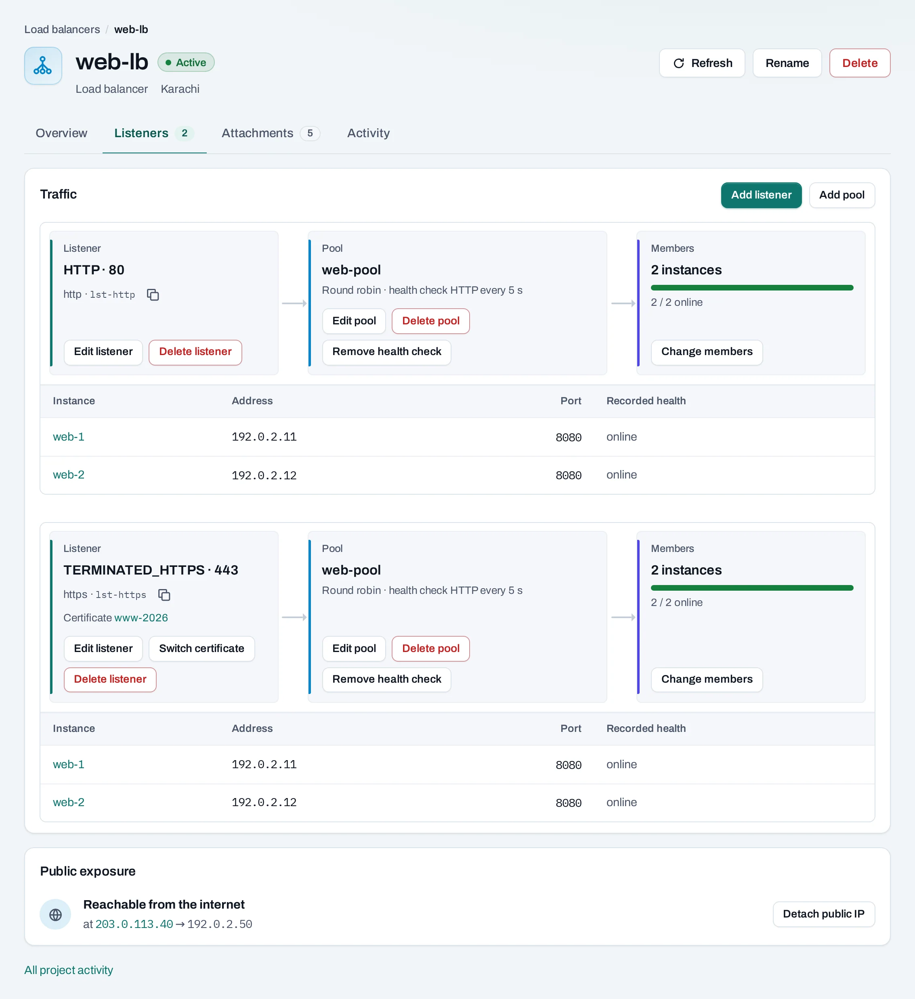
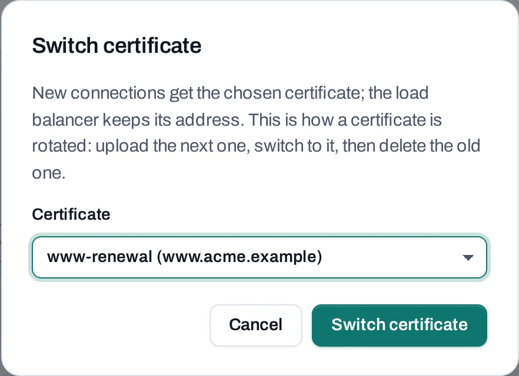

# Serve an application over HTTPS

Give several application instances one HTTPS endpoint. An Application load balancer terminates TLS with a certificate you upload and forwards traffic to its backend pool.

Show instructions for

<button type="button" data-interface-choice="Console" aria-pressed="true">Console</button><button type="button" data-interface-choice="API" aria-pressed="false">API</button>

[Set up API authentication and variables](/api/overview.md#before-you-start). Replace example IDs and catalog choices. `{P}` below means `/v1/orgs/{org_id}/projects/{project_id}`. Reuse an idempotency key for retries of one request; use a new key for each new action.

<figure class="docs-diagram">

<!-- diagram: https-application -->

<figcaption>The certificate is selected on the HTTPS listener. Backend reachability and application health must be checked separately.</figcaption>
</figure>

## Before you begin

You need a project location offering the Application load balancer type, two reachable backends serving your application, a domain you control and a valid certificate with its matching private key. Certificates are uploaded, not automatically issued or renewed by this page.

Keep all resources in one project and location. Decide the backend port and a health-check path. Ensure backend security groups and guest firewalls allow traffic from the balancer's network as required.

## Build the HTTPS frontend

=== "Console"

    1. Open **Security → Certificates → Upload certificate**. Upload the PEM leaf, matching unencrypted private key and required intermediate chain. Follow its operation and check expiry and domains.
    2. Open **Networking → Load balancers → Create load balancer**. Choose **Application**, the backend subnet and a recognizable name.
    3. Add an HTTPS listener on port 443 and select the uploaded certificate. Add a pool and the instances' private addresses and application ports.
    4. Add an HTTP health check with a path and expected status that represent application readiness. Follow creation until the tree is ready.
    5. Allocate a public IP and attach it to the load balancer. An Internet gateway and routed network are required.
    6. At your existing DNS provider, point the domain to that public IP. Wait for your DNS change to propagate.

    

=== "API"

    

    Create the certificate with `POST {P}/certificates` and follow its operation. Use an Application offering from the location's catalog for `POST {P}/load-balancers`.

    The API protocol for HTTPS termination is `TERMINATED_HTTPS`. Set the listener's `certificate_id`, pool, members and health check using the fields in the [load balancer reference](/api/reference/load-balancers.md). A Standard TCP listener does not terminate HTTPS.

    Allocate and associate the frontend address through the [public IP endpoints](/api/reference/public-ips.md). Follow each operation before a dependent change; the first `202` is not proof that the service is ready.

## Verify end to end

Open the actual domain over HTTPS or run `curl --fail https://YOUR_DOMAIN/`. Check the certificate covers the domain, its chain is trusted and the application responds. Backend health must be green; a load balancer's active state alone does not prove a member is serving correctly.

If you use a temporary public IP test, certificate name verification will not match the IP unless the certificate explicitly covers it. Prefer the real hostname rather than disabling TLS verification as your final test.

## Rotate a certificate

Upload the replacement first. On the balancer's **Listeners** tab choose **Switch certificate**, select the replacement and follow the operation. Verify the served certificate before deleting the old one.

A listener currently serves one selected certificate. Multiple-certificate SNI support is coming later. There is no automatic renewal in this workflow.

## Clean up

Update or remove DNS records, detach and release the public IP, then delete the load balancer. Its backend instances and uploaded certificates remain. Delete the unused certificate after no listener references it, and remove backend resources only if nothing else needs them.
