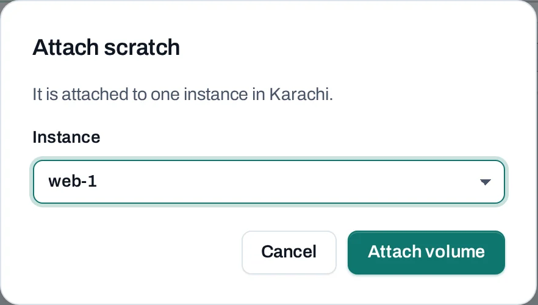

# Use persistent storage

Attach a new data volume to an instance and make it usable inside the guest. Keep application data on this volume when you want to replace the instance independently of its system disk.

<div class="docs-method-picker" hidden role="group" aria-label="Instruction method">
<span>Show instructions for</span>
<div><button type="button" data-interface-choice="Console" aria-pressed="true">Console</button><button type="button" data-interface-choice="API" aria-pressed="false">API</button></div>
</div>

<div class="docs-method-note" markdown>

[Set up API authentication and variables](/api/overview.md#before-you-start). Replace example IDs and catalog choices. `{P}` below means `/v1/orgs/{org_id}/projects/{project_id}`. Reuse an idempotency key for retries of one request; use a new key for each new action.

</div>


## Before you begin

You need a running Linux instance and access to administer its operating system. Choose the same project and location for the volume. A cloud attachment makes a disk available to the guest; it does not format or mount it.


## Create and attach the disk

=== "Console"

    1. Open **Storage → Volumes → Create volume**. Name it `app-data`, choose **Empty**, select an offered type and set the size.
    2. Wait for the create operation to succeed.
    3. Choose **Manage → Attach**, select the intended instance and follow the attach operation.
    4. Open the volume to confirm the named attachment. Keep its ID so that you can identify it later.

    

=== "API"

    <span id="with-the-api" data-docs-method="API"></span>

    [Create a volume](/storage/volumes.md) using `POST {P}/volumes`. After the create operation succeeds, attach it with `POST {P}/servers/{server_id}:attach-volume` and this body:

    ```json
    {"volume_id": "vol_example"}
    ```

    Use the [API example variables](/api/overview.md#before-you-start), replace the IDs, and follow both `202` operation results before relying on the disk. Read the volume's related resources to verify the attachment.


## Identify, format and mount

SSH into the instance and inspect its disks:

```bash
lsblk -o NAME,SIZE,FSTYPE,MOUNTPOINTS,SERIAL
```

Match the newly attached disk by its size and identity. The device name can differ between images and attachments; do not assume it is always `/dev/vdb`.

**Format only the new empty volume.** A restored disk or an existing data disk already has a filesystem; formatting it would destroy its contents. Replace `/dev/NEW_EMPTY_DISK` below after checking it:

```bash
sudo mkfs.ext4 /dev/NEW_EMPTY_DISK
sudo mkdir -p /srv/app-data
sudo mount /dev/NEW_EMPTY_DISK /srv/app-data
findmnt /srv/app-data
```

Set ownership for the application account rather than making the mount writable to everyone. To remount after reboot, read the filesystem UUID with `sudo blkid` and use that UUID in the guest's `/etc/fstab`. Test the entry before restarting; the cloud does not write the guest's mount configuration for you.

## Extend later

Stop application writes, unmount the filesystem and detach the volume first. Use its **Extend** action for a larger allocated size and wait until the operation succeeds. Reattach it, inspect the disk again, then grow its partition and filesystem with tools appropriate to the layout you created. Cloud extension alone does not grow a guest filesystem. Shrinking is not supported.

## Replace the instance or detach

Stop application writes, unmount the filesystem and detach the volume before moving it to another instance. A same-project replacement must be in the same location. Deleting the old instance leaves its separate data volume; it does not preserve the old system disk.

Verify the application can read its data after reattachment. Keep a [tested recovery point](/tutorials/recover-a-volume.md), and delete the volume only after you no longer need its contents.
