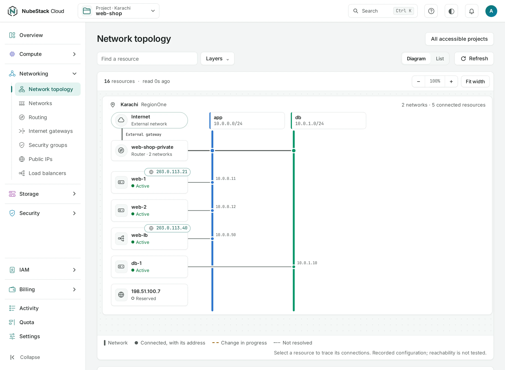

# Connect private services

Connect a web tier to a database tier in one location without giving the database a public IP. This combines private routing with narrowly scoped security-group rules.

Show instructions for

<button type="button" data-interface-choice="Console" aria-pressed="true">Console</button><button type="button" data-interface-choice="API" aria-pressed="false">API</button>

[Set up API authentication and variables](/api/overview.md#before-you-start). Replace example IDs and catalog choices. `{P}` below means `/v1/orgs/{org_id}/projects/{project_id}`. Reuse an idempotency key for retries of one request; use a new key for each new action.

## Plan the connection

Use one project and one location. For a private example, use `10.20.0.0/24` for `app` and `10.20.1.0/24` for `data`, after checking these ranges do not overlap your existing networks. Choose two private, non-overlapping CIDRs within the supported range sizes. Keep the database's address stable using the network's reserved static range if your application configuration needs it. Do not copy the reserved documentation addresses from screenshots into a real network configuration.

| Resource | Intended access |
|---|---|
| Application network | Routed; Internet access only where needed |
| Data network | Routed privately to the application network |
| Web instance | Public frontend or a load balancer; restricted administrative access |
| Database instance | No public IP; accept the database port only from the application tier |

## Build the private path

=== "Console"

    1. Create `app` and `data` networks in the same location. Choose **Routed** for both to join the project's private routing.
    2. Create the web instance on `app` and the database instance on `data`.
    3. Create a database security group. Allow ingress on the database's actual TCP port from the application CIDR, or use a supported remote security-group rule where appropriate. Do not open the database port to `0.0.0.0/0`.
    4. Attach the groups to the intended instances. Inspect existing groups too: rules are additive, so an overly broad rule in another attached group can still permit traffic.
    5. Use **Network topology** to inspect the instances, network ranges and router connections.

    

=== "API"

    

    Create each network with `POST {P}/networks`, a valid private `subnet.cidr` and `routed: true`. Follow each operation. The `:set-routing` network action connects an existing isolated network to private routing.

    Create or update [security groups](/networking/security-groups.md) and their rules, then use `POST {P}/servers/{id}:set-security-groups` for the intended instance selection. Inspect the [Networking reference](/api/reference/networking.md) and [Security groups reference](/api/reference/security-groups.md) for exact fields. A firewall change returns an operation too.

## Verify from both sides

From the web instance, connect to the database's private address using the application's database client. Check the database is bound to the intended guest interface and its guest firewall allows the connection.

Verify that an unintended source cannot connect. Routing alone is not an access policy. If the path fails, check ranges do not overlap, both networks are routed, security groups allow the protocol and port, and the guest service is listening.

## Internet access and cleanup

An isolated network cannot reach other networks through the project's router. Detaching from private routing also removes its path through the Internet gateway; attached public IPs can block that detach.

The project Internet gateway can provide outbound access to routed networks. **No public IP** on the database prevents that direct inbound endpoint, but is not a substitute for firewall rules. There is no private network spanning Karachi and Islamabad.

Remove instances or their interfaces before deleting networks. Detach public IPs before removing routing that they depend on. Review [the delete dependencies](/tutorials/clean-up-resources.md) when cleaning up.
