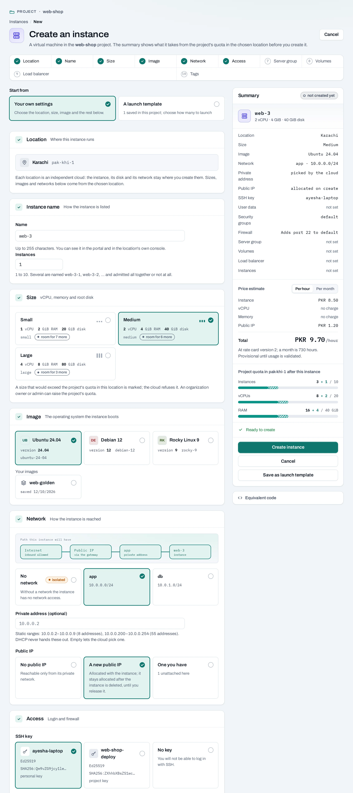

# Publish a web application

Launch a small Ubuntu web server and verify that its HTTP endpoint is reachable. This is a starting point for an application, not a highly available production design. The example installs Nginx using cloud-init; replace it with your application setup later.

<div class="guide-summary" markdown>

**You will use:** an instance, SSH key, network, Internet gateway and public IP. **Result:** a reachable HTTP service in one location.

</div>

## Before you begin

Create a [project](/get-started/create-a-project.md) and register your [public SSH key](/compute/ssh-keys.md). You need project-member or project-admin access and enough quota. Choose a supported Ubuntu image and size from the location's catalog. The addresses in screenshots are examples; use the address actually allocated to you.

<!-- methods -->
## Create the web server

1. Choose your project and location. Confirm the network is **Routed** and the location has an [Internet gateway](/networking/internet-gateways.md).
2. Open **Compute → Instances → Create instance**. Name the server `web-1`, choose Ubuntu and a size, and select the network.
3. Select your SSH key. Allow TCP 80 for public HTTP. For SSH, prefer a security-group rule restricted to your own address rather than opening port 22 to everyone.
4. Choose **A new public IP**. Review where the create-page shortcuts will add firewall rules; modifying a shared group affects its other instances.
5. Paste this into **User data (cloud-init)**:

   ```yaml
   #cloud-config
   package_update: true
   packages:
     - nginx
   runcmd:
     - [systemctl, enable, --now, nginx]
   ```

6. Review the resource and quota summary, then create. Follow the operation until it succeeds. Cloud-init can continue installing software after the cloud reports the instance active.



## With the API

Use the [instance create example](/compute/instances.md) with a valid location, image, size, network and SSH key. `POST {P}/servers` accepts the request with `202`; save and follow its operation link. `{P}` is the project API path.

The API's `user_data` is base64-encoded. To prepare the same cloud-init document from a local `cloud-init.yaml` file:

```bash
python3 -c 'import base64,pathlib; print(base64.b64encode(pathlib.Path("cloud-init.yaml").read_bytes()).decode())'
```

Put that encoded value into the create body's `user_data`. Select the required security groups explicitly or use the documented firewall templates. Use a stable idempotency key for retries of the same request. The [reference](/api/reference/instances.md#post-server) lists all create fields.

## Verify the application

Find the allocated public IP on the instance page. Replace the example below with it:

```bash
curl --fail http://203.0.113.21/
ssh ubuntu@203.0.113.21
```

On the instance, `cloud-init status --wait` waits for first-boot configuration. Then check `systemctl status nginx` and the guest firewall. An active VM does not prove the application installation succeeded. If HTTP times out, check the public IP, gateway, routing and security group before repeatedly rebooting.

## Add a domain or HTTPS

You can create an A record at your DNS provider pointing to the allocated public IP. This guide does not imply a managed DNS service. For a shared HTTPS frontend and several backends, continue with [an HTTPS load balancer](/tutorials/https-load-balancer.md).

## Clean up

Delete the instance and follow its operation. Release its public IP separately. Remove an Internet gateway or dedicated security group only if no other service needs it. Separate volumes, snapshots and saved images need their own cleanup; [the cleanup guide](/tutorials/clean-up-resources.md) explains the order.
