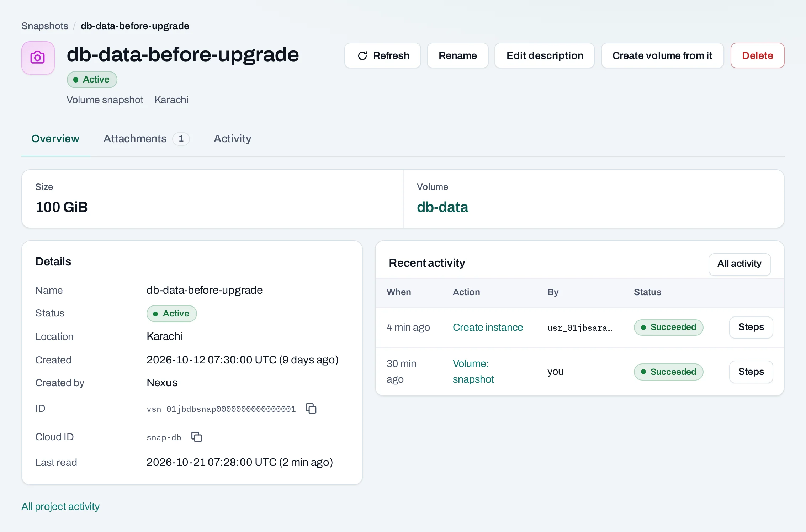
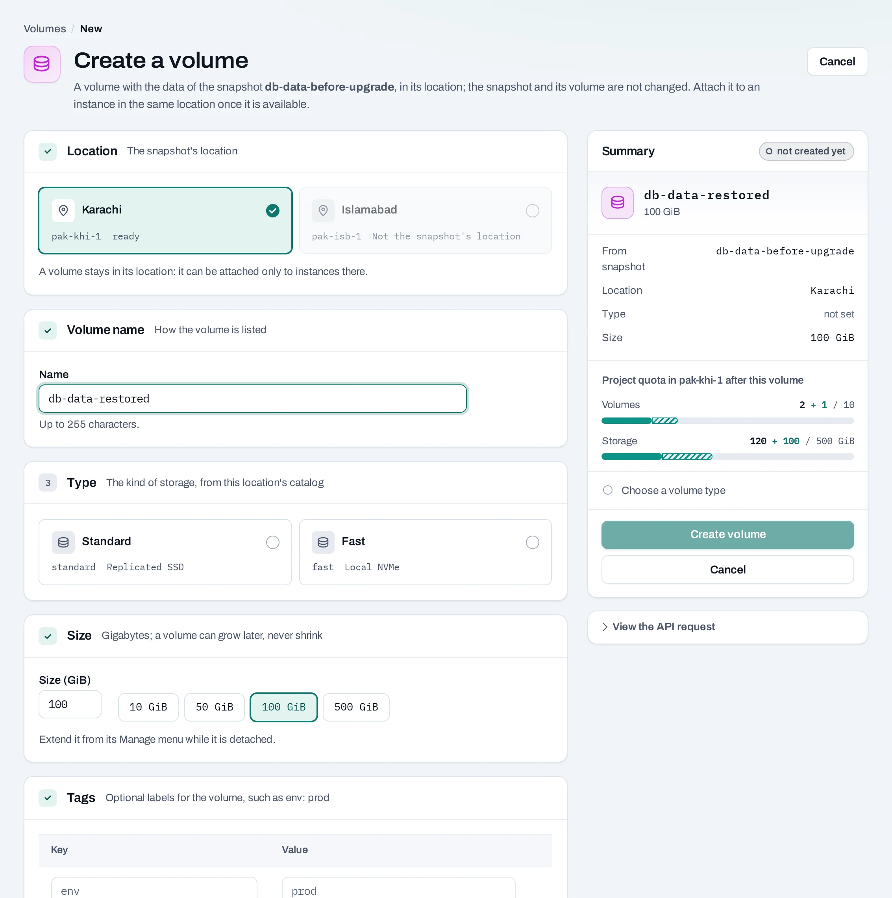

# Recover a volume from a snapshot

Create a recovery point, restore it into a new volume and inspect the data without overwriting the source. Use this workflow before an application change or when testing your recovery procedure.

<figure class="docs-diagram">

<!-- diagram: storage-recovery -->

<figcaption>Snapshots share their source storage. Restoring creates another volume; it does not replace the original.</figcaption>
</figure>

## Before you begin

Identify which volume contains the application data. A snapshot of a data volume does not capture the instance's image-backed system disk, running memory or application transactions.

!!! warning "A recovery point is not an independent backup"

    Snapshots remain in the same storage as the volume. They help undo changes, but do not protect against losing that storage. NubeStack Cloud does not currently offer backup copies to separate storage. Keep an independent application backup where your recovery requirements call for one.

<!-- methods -->
## Create and restore a recovery point

1. Stop application writes. For a manual snapshot, unmount and detach the volume; stopping the instance alone does not detach it.
2. On **Volumes**, choose **Manage → Create snapshot**, give it a recognizable name and follow the operation.
3. Under **Snapshots**, inspect the new copy and its source volume. Wait for it to become available.
4. Choose **Manage → Create volume from it**. Name the new volume `app-data-restored`, choose a type and a size at least as large as the snapshot.
5. Follow the restore/create operation. Keep the source volume and snapshot unchanged while testing.

For recurring recovery points, create a **Back up volumes** schedule. It snapshots selected attached volumes on its timetable without pausing applications. Choose retention deliberately: it prunes only its own older snapshots.

## With the API

Create a detached volume's snapshot with `POST {P}/volumes/{volume_id}:snapshot` and a `display_name`. Poll the returned operation.

Restore with `POST {P}/volumes`, supplying the source `snapshot_id`, location, name, size and volume type. This is a new volume, not an in-place restore. [The volume guide](/storage/volumes.md) and [reference](/api/reference/volumes-and-snapshots.md) show the body fields.

A recurring snapshot schedule is a saved definition: [schedule creation](/storage/schedules.md) returns `201`, and its later runs create operations. Do not wait for an operation on the schedule-save response.

## Test the restored data

Attach the restored volume to a recovery instance in the same project and location. Identify its filesystem and mount it without formatting. For inspection, prefer a read-only mount and do not attach the source and restored filesystem indiscriminately when they share a filesystem UUID.

Check representative files and the application's own consistency checks. A successful snapshot operation does not prove a database can recover or that several volumes represent one consistent transaction point. Record what you verified and how long it took.

## Cut over and clean up

If you intend to replace the application disk, stop writes, unmount the old disk, detach it and attach the restored disk. Update mount configuration if required, then test before resuming traffic. Keep the old volume until the cutover is verified.

Delete test volumes and obsolete snapshots explicitly. Deleting a schedule leaves its existing snapshots and stops pruning them; it does not clean up your test copies.
