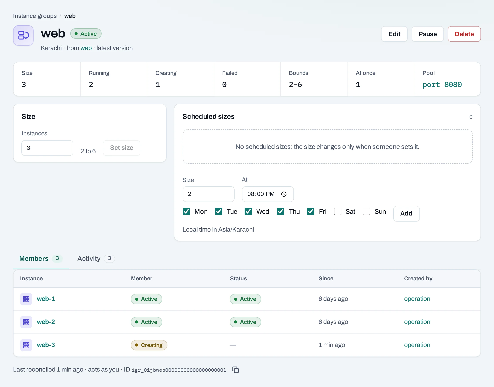
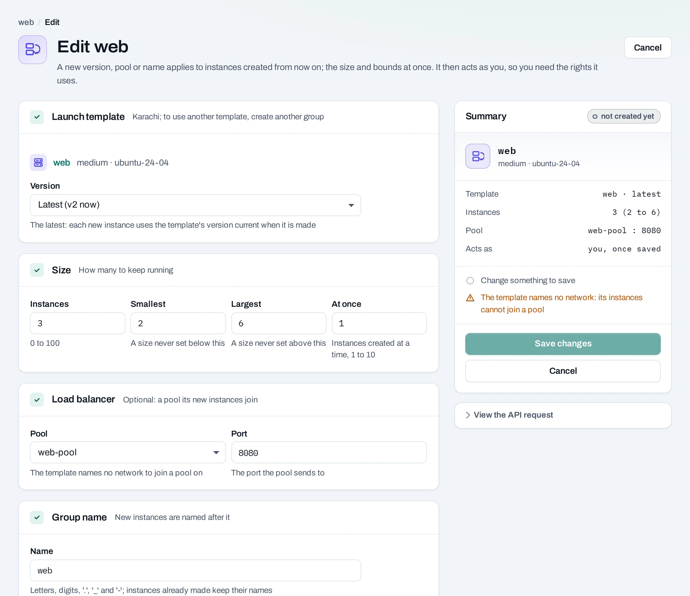

# Scale application replicas

Keep a desired number of replaceable application instances running from a launch template, optionally registering them in a load balancer pool. Manual and scheduled desired counts are supported; metric-triggered autoscaling is not offered here.

Show instructions for

<button type="button" data-interface-choice="Console" aria-pressed="true">Console</button><button type="button" data-interface-choice="API" aria-pressed="false">API</button>

[Set up API authentication and variables](../api/index.md#before-you-start). Replace example IDs and catalog choices. `{P}` below means `/v1/orgs/{org_id}/projects/{project_id}`. Reuse an idempotency key for retries of one request; use a new key for each new action.

## Prepare a repeatable instance

Test the image, cloud-init configuration and guest service on one instance first. Store durable application state outside replaceable system disks. The template's network and any load balancer pool must be in the group's location.

A server group controls sharing or spreading hosts; an instance group controls the count. These solve different problems. To spread replicas, include the chosen server group when preparing the template.

## Create and scale the group

=== "Console"

    1. Save the working configuration as a [launch template](../compute/launch-templates.md). Pin its version when you want predictable replacements.
    2. Open **Compute → Instance groups → Create instance group**. Choose the template, a desired count, minimum and maximum, and how many creates may run at once.
    3. Optionally select a load balancer pool and the backend port. Group-created members join the pool once running and leave before deletion.
    4. Create the group, then inspect member state and linked operations until the desired count is reached.
    5. Change **Size** to add or remove replicas within the bounds. Scaling down deletes instances; plan for interrupted requests and local data loss.
    6. Add **Scheduled sizes** for recurring busy or quiet periods. Review the local time zone and next run.

    

    

=== "API"

    

    Create a template with `POST {P}/launch-templates`, then a group with `POST {P}/instance-groups`. Both return the saved definition with `201` rather than a single provisioning operation. Inspect the group's members and the operations creating them.

    Update desired size with `PATCH {P}/instance-groups/{id}` and the current ETag in `If-Match`. A size schedule uses the schedule kind `resize`, an `instance_group` target and the desired count. Use the [group](../api/reference/instance-groups.md) and [schedule](../api/reference/schedules.md) reference for exact request fields.

## Verify and maintain

Check both the group's count and application readiness behind its load balancer. Replacement detects failed instances, not every application defect. Bad configuration can repeatedly fail creates and cause the group to pause; inspect the reason instead of repeatedly resuming unchanged.

A new template version affects future creates and replacements. It does not roll every existing member automatically. Plan your application rollout explicitly.

## Pause or stop using the group

**Pause** keeps existing instances running and stops reconciliation. It is useful before investigating or intentionally changing a member; manually deleting an active group's member can otherwise trigger replacement.

On deletion choose whether to keep the instances as ordinary instances or delete them too. Keeping them retains their usage. Review size schedules, public IP allocations, attached data volumes and the load balancer separately during cleanup.
